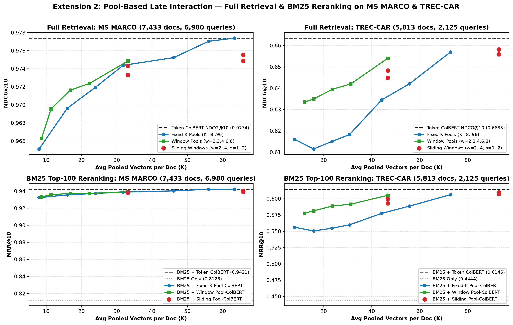

# Extension 2: Pool-Based Late Interaction — Results (MS MARCO & TREC-CAR)

Model: `jinaai/jina-colbert-v1-en` (pretrained), dim 128, `query_maxlen = 32`, `doc_maxlen = 220`.
Notebook: `evaluation/pool_late_interaction.ipynb` | Script: `scripts/pool_late_interaction.py` | Raw JSONs: `results/pool_late_interaction_msmarco_dev.json`, `results/pool_late_interaction_trec-car_test.json`.

**Method (from slides):** Divide each document's token embeddings into $K$ contiguous local pools, mean-pool and $L_2$-normalize each pool, and compute late interaction:

$$P_k = \text{Norm}\!\left(\text{Pool}\!\left(E_{d_{a_k}}, \ldots, E_{d_{b_k}}\right)\right), \qquad S(q, d) = \sum_{i=1}^{|q|} \max_{k=1,\ldots,K} \left(E_{q_i}^T P_k\right)$$

---

## 1. MS MARCO (`data/msmarco`: 7,433 Passages, 6,980 Dev Queries, 65.8 tokens/doc)

### 1.1 Setup 1: Full-Corpus Retrieval
| Configuration | Avg vectors/doc | Compression | Index Size (fp16) | NDCG@10 | MRR@10 | Recall@100 | MAP@10 | Time (ms) |
|---|---:|---:|---:|---:|---:|---:|---:|---:|
| **Token-level ColBERT (no pooling** | 65.8 | 1.00× | 119.3 MB | 0.9774 | 0.9717 | 0.9989 | 0.9702 | 327689.3 |
| Fixed K=8 | 8.0 | 8.22× | 14.5 MB | 0.9651 | 0.9562 | 0.9985 | 0.9538 | 8881.6 |
| Fixed K=16 | 16.0 | 4.11× | 29.0 MB | 0.9696 | 0.9619 | 0.9987 | 0.9600 | 17010.1 |
| Fixed K=24 | 24.0 | 2.74× | 43.5 MB | 0.9719 | 0.9645 | 0.9987 | 0.9627 | 21946.1 |
| Fixed K=32 | 31.8 | 2.07× | 57.7 MB | 0.9744 | 0.9678 | 0.9989 | 0.9658 | 27663.7 |
| Fixed K=48 | 46.1 | 1.43× | 83.7 MB | 0.9752 | 0.9691 | 0.9989 | 0.9671 | 40977.8 |
| Fixed K=64 | 56.0 | 1.17× | 101.6 MB | 0.9770 | 0.9714 | 0.9989 | 0.9695 | 56455.5 |
| Fixed K=96 | 63.3 | 1.04× | 114.9 MB | 0.9774 | 0.9718 | 0.9989 | 0.9701 | 87225.4 |
| Fixed K=32, Max | 31.8 | 2.07× | 57.7 MB | 0.9599 | 0.9501 | 0.9985 | 0.9476 | 28671.8 |
| Fixed K=64, Max | 56.0 | 1.17× | 101.6 MB | 0.9749 | 0.9686 | 0.9989 | 0.9666 | 54899.9 |
| Window w=2 | 33.1 | 1.98× | 60.1 MB | 0.9748 | 0.9682 | 0.9989 | 0.9667 | 87447.8 |
| Window w=3 | 22.3 | 2.95× | 40.4 MB | 0.9724 | 0.9651 | 0.9987 | 0.9635 | 58539.3 |
| Window w=4 | 16.8 | 3.91× | 30.5 MB | 0.9716 | 0.9643 | 0.9986 | 0.9625 | 44373.4 |
| Window w=6 | 11.4 | 5.78× | 20.6 MB | 0.9695 | 0.9617 | 0.9987 | 0.9597 | 28459.2 |
| Window w=8 | 8.7 | 7.59× | 15.7 MB | 0.9663 | 0.9575 | 0.9986 | 0.9553 | 24119.4 |
| Sliding w=2, s=1 | 65.8 | 1.00× | 119.3 MB | 0.9755 | 0.9691 | 0.9989 | 0.9675 | 364000.6 |
| Sliding w=3, s=1 | 65.8 | 1.00× | 119.3 MB | 0.9749 | 0.9683 | 0.9986 | 0.9667 | 355657.2 |
| Sliding w=3, s=2 | 33.1 | 1.98× | 60.1 MB | 0.9743 | 0.9677 | 0.9986 | 0.9661 | 107538.3 |
| Sliding w=4, s=2 | 33.1 | 1.98× | 60.1 MB | 0.9733 | 0.9664 | 0.9987 | 0.9647 | 149314.2 |

### 1.2 Setup 2: BM25 Top-100 Candidate Reranking
| Configuration | Avg vectors/doc | Compression | MRR@10 | Recall@50 | MAP@100 | NDCG@10 |
|---|---:|---:|---:|---:|---:|---:|
| *BM25 only* | – | – | 0.8123 | 0.9530 | 0.8087 | 0.8366 |
| **BM25 + Token-level ColBERT (no pooling** | 65.8 | 1.00× | 0.9421 | 0.9609 | 0.9393 | 0.9468 |
| BM25 + Fixed K=8 | 8.0 | 8.22× | 0.9324 | 0.9609 | 0.9291 | 0.9392 |
| BM25 + Fixed K=16 | 16.0 | 4.11× | 0.9355 | 0.9609 | 0.9326 | 0.9417 |
| BM25 + Fixed K=24 | 24.0 | 2.74× | 0.9373 | 0.9609 | 0.9343 | 0.9431 |
| BM25 + Fixed K=32 | 31.8 | 2.07× | 0.9388 | 0.9609 | 0.9359 | 0.9443 |
| BM25 + Fixed K=48 | 46.1 | 1.43× | 0.9403 | 0.9609 | 0.9373 | 0.9453 |
| BM25 + Fixed K=64 | 56.0 | 1.17× | 0.9422 | 0.9609 | 0.9391 | 0.9467 |
| BM25 + Fixed K=96 | 63.3 | 1.04× | 0.9423 | 0.9609 | 0.9393 | 0.9468 |
| BM25 + Fixed K=32, Max | 31.8 | 2.07× | 0.9272 | 0.9609 | 0.9239 | 0.9350 |
| BM25 + Fixed K=64, Max | 56.0 | 1.17× | 0.9398 | 0.9609 | 0.9367 | 0.9449 |
| BM25 + Window w=2 | 33.1 | 1.98× | 0.9394 | 0.9609 | 0.9367 | 0.9449 |
| BM25 + Window w=3 | 22.3 | 2.95× | 0.9373 | 0.9609 | 0.9346 | 0.9432 |
| BM25 + Window w=4 | 16.8 | 3.91× | 0.9374 | 0.9609 | 0.9345 | 0.9432 |
| BM25 + Window w=6 | 11.4 | 5.78× | 0.9357 | 0.9609 | 0.9328 | 0.9419 |
| BM25 + Window w=8 | 8.7 | 7.59× | 0.9332 | 0.9608 | 0.9302 | 0.9400 |
| BM25 + Sliding w=2, s=1 | 65.8 | 1.00× | 0.9404 | 0.9609 | 0.9376 | 0.9455 |
| BM25 + Sliding w=3, s=1 | 65.8 | 1.00× | 0.9390 | 0.9609 | 0.9362 | 0.9444 |
| BM25 + Sliding w=3, s=2 | 33.1 | 1.98× | 0.9386 | 0.9609 | 0.9359 | 0.9442 |
| BM25 + Sliding w=4, s=2 | 33.1 | 1.98× | 0.9381 | 0.9609 | 0.9353 | 0.9437 |

---

## 2. TREC-CAR (`data/trec-car`: 5,813 Passages, 2,125 Test Queries, 92.9 tokens/doc)

### 2.1 Setup 1: Full-Corpus Retrieval
| Configuration | Avg vectors/doc | Compression | Index Size (fp16) | NDCG@10 | MRR@10 | Recall@100 | MAP@10 | Time (ms) |
|---|---:|---:|---:|---:|---:|---:|---:|---:|
| **Token-level ColBERT (no pooling** | 92.9 | 1.00× | 131.8 MB | 0.6635 | 0.6206 | 0.9330 | 0.4591 | 95905.9 |
| Fixed K=8 | 8.0 | 11.64× | 11.3 MB | 0.6159 | 0.5611 | 0.9352 | 0.4111 | 2613.1 |
| Fixed K=16 | 15.8 | 5.86× | 22.5 MB | 0.6115 | 0.5549 | 0.9403 | 0.4069 | 3916.4 |
| Fixed K=24 | 23.5 | 3.96× | 33.3 MB | 0.6150 | 0.5586 | 0.9408 | 0.4101 | 6195.7 |
| Fixed K=32 | 30.7 | 3.02× | 43.6 MB | 0.6182 | 0.5646 | 0.9404 | 0.4144 | 8046.8 |
| Fixed K=48 | 44.2 | 2.10× | 62.7 MB | 0.6345 | 0.5840 | 0.9394 | 0.4331 | 11112.7 |
| Fixed K=64 | 55.7 | 1.67× | 79.1 MB | 0.6420 | 0.5951 | 0.9398 | 0.4376 | 16130.2 |
| Fixed K=96 | 72.9 | 1.27× | 103.4 MB | 0.6570 | 0.6135 | 0.9354 | 0.4529 | 24628.2 |
| Fixed K=32, Max | 30.7 | 3.02× | 43.6 MB | 0.4986 | 0.4422 | 0.9087 | 0.2997 | 7835.5 |
| Fixed K=64, Max | 55.7 | 1.67× | 79.1 MB | 0.6114 | 0.5600 | 0.9355 | 0.4037 | 14406.9 |
| Window w=2 | 46.7 | 1.99× | 66.3 MB | 0.6540 | 0.6117 | 0.9329 | 0.4485 | 32675.7 |
| Window w=3 | 31.3 | 2.97× | 44.4 MB | 0.6420 | 0.5985 | 0.9341 | 0.4391 | 17248.3 |
| Window w=4 | 23.6 | 3.94× | 33.5 MB | 0.6395 | 0.5941 | 0.9335 | 0.4354 | 17604.3 |
| Window w=6 | 15.9 | 5.85× | 22.6 MB | 0.6349 | 0.5872 | 0.9333 | 0.4303 | 8727.3 |
| Window w=8 | 12.1 | 7.71× | 17.1 MB | 0.6335 | 0.5840 | 0.9322 | 0.4270 | 7297.5 |
| Sliding w=2, s=1 | 92.9 | 1.00× | 131.8 MB | 0.6581 | 0.6162 | 0.9331 | 0.4541 | 94509.9 |
| Sliding w=3, s=1 | 92.9 | 1.00× | 131.8 MB | 0.6559 | 0.6139 | 0.9362 | 0.4516 | 98128.2 |
| Sliding w=3, s=2 | 46.7 | 1.99× | 66.3 MB | 0.6482 | 0.6060 | 0.9334 | 0.4438 | 48711.9 |
| Sliding w=4, s=2 | 46.7 | 1.99× | 66.3 MB | 0.6448 | 0.6000 | 0.9349 | 0.4398 | 46906.1 |

### 2.2 Setup 2: BM25 Top-100 Candidate Reranking
| Configuration | Avg vectors/doc | Compression | MRR@10 | Recall@50 | MAP@100 | NDCG@10 |
|---|---:|---:|---:|---:|---:|---:|
| *BM25 only* | – | – | 0.4444 | 0.7469 | 0.3339 | 0.5016 |
| **BM25 + Token-level ColBERT (no pooling** | 92.9 | 1.00× | 0.6146 | 0.8011 | 0.4725 | 0.6546 |
| BM25 + Fixed K=8 | 8.0 | 11.64× | 0.5561 | 0.8041 | 0.4281 | 0.6097 |
| BM25 + Fixed K=16 | 15.8 | 5.86× | 0.5504 | 0.8044 | 0.4247 | 0.6055 |
| BM25 + Fixed K=24 | 23.5 | 3.96× | 0.5546 | 0.8051 | 0.4274 | 0.6096 |
| BM25 + Fixed K=32 | 30.7 | 3.02× | 0.5598 | 0.8046 | 0.4306 | 0.6110 |
| BM25 + Fixed K=48 | 44.2 | 2.10× | 0.5774 | 0.8056 | 0.4474 | 0.6264 |
| BM25 + Fixed K=64 | 55.7 | 1.67× | 0.5885 | 0.8059 | 0.4522 | 0.6341 |
| BM25 + Fixed K=96 | 72.9 | 1.27× | 0.6062 | 0.8027 | 0.4658 | 0.6475 |
| BM25 + Fixed K=32, Max | 30.7 | 3.02× | 0.4411 | 0.7910 | 0.3270 | 0.4997 |
| BM25 + Fixed K=64, Max | 55.7 | 1.67× | 0.5539 | 0.8036 | 0.4207 | 0.6043 |
| BM25 + Window w=2 | 46.7 | 1.99× | 0.6051 | 0.8013 | 0.4635 | 0.6465 |
| BM25 + Window w=3 | 31.3 | 2.97× | 0.5915 | 0.8000 | 0.4538 | 0.6349 |
| BM25 + Window w=4 | 23.6 | 3.94× | 0.5886 | 0.7998 | 0.4505 | 0.6320 |
| BM25 + Window w=6 | 15.9 | 5.85× | 0.5814 | 0.8005 | 0.4460 | 0.6282 |
| BM25 + Window w=8 | 12.1 | 7.71× | 0.5777 | 0.8003 | 0.4440 | 0.6262 |
| BM25 + Sliding w=2, s=1 | 92.9 | 1.00× | 0.6095 | 0.8014 | 0.4679 | 0.6509 |
| BM25 + Sliding w=3, s=1 | 92.9 | 1.00× | 0.6070 | 0.8015 | 0.4655 | 0.6478 |
| BM25 + Sliding w=3, s=2 | 46.7 | 1.99× | 0.5996 | 0.8010 | 0.4582 | 0.6409 |
| BM25 + Sliding w=4, s=2 | 46.7 | 1.99× | 0.5929 | 0.8010 | 0.4542 | 0.6359 |

---

## 3. Qualitative Case Studies (Resolving the "Vitamin D" Context Trap)

- **TREC-CAR (`qid = Migrant%20domestic%20workers/Vulnerability%20to%20abuse/Lasting%20effects%20of%20abuse`):**
  - *Query:* `"Migrant domestic workers Vulnerability to abuse Lasting effects of abuse"`
  - *Token-Level ColBERT Baseline:* Ranks a general passage about `"Migrant domestic workers... vulnerable"` (`doc 99adc28c...`) at Rank #1 due to isolated keyword overlap, pushing the ground-truth passage (`doc 24145c82...`: `"Even when migrant domestic workers return to their native countries, abuse experienced during their domestic employment abroad can have lasting effects..."`) to **Rank #6**.
  - *Window Pooling (`Window w=2, Mean`):* Captures the local phrase `"lasting effects"` and promotes the ground-truth passage from **Rank #6 → Rank #1**.
- **MS MARCO (`qid = 1038830`):**
  - *Query:* `"what is the gpa requirement for usd"`
  - *Token-Level ColBERT Baseline:* Ranks a generic `"Dental Hygiene program... GPA of 2.5"` passage (`doc 7743190`) at Rank #1, placing the true University of San Diego GPA passage (`doc 7203741`) at **Rank #4**.
  - *Window Pooling (`Window w=2, Mean`):* Promotes the ground-truth passage from **Rank #4 → Rank #1**.
